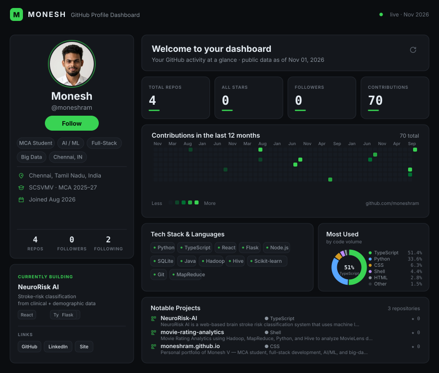

<!--
  Dashboard is generated - do not hand-edit assets/dashboard.svg.
  Refresh stats with:  python3 scripts/build_dashboard.py
-->

 

<b>About · Education · Focus</b>

 

|  |  |
|:---|:---|
| **Now** | MCA at Sri Chandrasekharendra Saraswathi Viswa Mahavidyalaya (2025–27) · CGPA 8.06 |
| **Before** | BCA at Dr. M.G.R. Educational and Research Institute (2024) · CGPA 7.79 |
| **Based in** | Chennai, Tamil Nadu, India |
| **Focus** | Applied ML · full-stack engineering · big-data analytics |
| **Building** | NeuroRisk AI — brain-stroke risk classification from clinical and demographic inputs |

Learning by building · sharing what I learn · growing one project at a time.

Dashboard data refreshes via <code>scripts/build_dashboard.py</code> · palette <code>#0B0D10</code> / <code>#14171C</code> / <code>#39D353</code>

